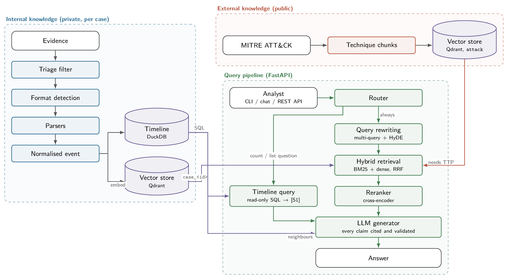

# Digital Forensic Assistant — Retrieval & Rerank RAG for Incident Response

An assistant for cyber incident response (IR) analysts. The analyst provides
**observations** (forensic artefacts: logs, events, network captures, later disk
and memory images) and asks questions in natural language. The system answers
**grounded in that evidence**, and pulls in **external knowledge** (MITRE ATT&CK)
only when a query needs it.

Everything runs **locally**: private log data never leaves the machine.

---

## Table of contents

1. [Goals](#1-goals)
2. [Architecture](#2-architecture)
3. [Knowledge sources](#3-knowledge-sources)
4. [Query pipeline](#4-query-pipeline)
5. [Models](#5-models)
6. [Repository layout](#6-repository-layout)
7. [Installation](#7-installation)
8. [Usage](#8-usage)
9. [Configuration](#9-configuration)
10. [Sample evidence](#10-sample-evidence)
11. [Roadmap / TODO](#11-roadmap--todo)
12. [Security & privacy notes](#12-security--privacy-notes)

---

## 1. Goals

| Goal | How |
|---|---|
| Make investigations faster | Ask questions over thousands of events instead of grepping by hand |
| Answers grounded in evidence | Every claim cites the retrieved chunks (file, line/record, timestamp) |
| Exact numbers for aggregate questions | Counts and exhaustive lists come from a SQL query over the whole timeline, not from a sample of chunks |
| Map findings to adversary behaviour | ATT&CK techniques retrieved on demand and cited by ID (e.g. `T1059.001`) |
| Handle heterogeneous artefacts | Per-format parsers normalise everything into one event schema |
| Stay private | Local LLM, local embeddings, local vector store; no outbound calls |
| Stay current | ATT&CK is re-ingested on every release |

---

## 2. Architecture



*Vector version and TikZ source for slides: [`docs/figures/`](docs/figures/README.md).*

**Text version of the flow**

```
analyst query
   │
   ▼
[Router]  ── classifies the query ──►  evidence_only | evidence+attack | attack_only
   │         and flags counting / listing questions
   ├──────────────────────────────────────────────────────────────────────────────┐
   ▼                                                                              ▼
[Query rewriting]                                             [Timeline query]  LLM writes one read-only SQL SELECT
                                                              over the DuckDB timeline (validated, executed) ──► [S1]  ── multi-query + HyDE (hypothetical evidence line) ──►  N sub-queries
   │
   ▼
[Hybrid retrieval]  ── BM25 (exact IOCs, hashes, hostnames)  +  dense (semantic)  ──►  top-k per source
   │                                                          fused with Reciprocal Rank Fusion
   ▼
[Reranker]  ── cross-encoder scores (query, chunk) pairs ──►  top-n
   │
   ▼
[Generator]  ── context window: [S1] query result + evidence chunks + timeline slice + ATT&CK entries ──►  answer + citations
```

Key design decisions:

* **Two-tier retrieval.** Internal evidence is always searched. External
  corpora are searched only when the router says so, which keeps the context
  window focused on the case and avoids "textbook" answers that ignore the logs.
* **Hybrid search.** IR queries are full of exact tokens (IPs, hashes,
  usernames, event IDs). Dense embeddings alone are bad at these; BM25 catches
  them. Results are fused with Reciprocal Rank Fusion (RRF), then reranked.
* **One normalised event schema.** Every parser emits the same record shape so
  the retriever, timeline and generator do not care where an event came from.
* **Case isolation.** Each investigation is a separate vector-store collection
  (`case_<id>`) so evidence from one case never bleeds into another.
* **Multi-hop retrieval.** Some answers need a record that shares no words with
  the question: "creation time of the parent of powershell.exe" needs the parent's
  own process row, which the first retrieval finds only through the child's PPID.
  After the first context is built, the model is asked whether it is sufficient
  and, if not, for up to three follow-up lookups phrased with the identifiers it
  saw (PIDs, IPs, hashes, users, file names). Each follow-up is retrieved and
  reranked against its own text, the new hits are merged into the context, and
  the answer is generated once. The lookups are shown under the answer
  (`hop: pslist PID 4352 CreateTime (+5 evidence) ...`) and recorded in the audit
  log. `retrieval.hops: 0` disables it; `hop_followups` and `hop_keep` bound it.
* **Retrieval is a sample, SQL is the census.** Top-k chunks can never answer
  "how many" or "list every". For such questions the LLM writes a `SELECT` over
  the DuckDB timeline (schema + distinct values are in the prompt), the query is
  validated (single read-only statement, no file functions) and its result goes
  into the context as `[S1]`, which the answer prompt treats as authoritative.

---

## 3. Knowledge sources

### 3.1 External knowledge (public, used on demand)

| Source | Format | Ingestion | Refresh |
|---|---|---|---|
| MITRE ATT&CK (Enterprise, Mobile, ICS) | STIX 2.1 JSON from `mitre-attack/attack-stix-data` | One chunk per technique / sub-technique / group / software / mitigation, with metadata `{attack_id, tactic, platforms, version}` | `make update-attack` (idempotent, upserts by `attack_id`) |

### 3.2 Internal knowledge (private, the heart of every answer)

| Format | Parser | Notes |
|---|---|---|
| JSON / JSONL logs | `parsers/json_logs.py` | JSON-lines, arrays and wrapped arrays; field mapping for ECS, Sysmon, CloudTrail, Winlogbeat or ad-hoc schemas |
| Syslog (RFC 3164 / 5424 / ISO) | `parsers/syslog.py` | auth, secure, messages, daemon, kern; sshd, sudo, su, cron and PAM events classified |
| EVTX (binary or XML export) | `parsers/evtx.py` | Security, System, Sysmon, PowerShell and other channels; ~50 well-known event IDs get readable summaries |
| CSV / TSV / W3C / Zeek | `parsers/csv_logs.py` | Dialect sniffing, W3C and Zeek headers; EDR / SIEM exports, Autoruns, KAPE outputs |
| Apache / Nginx access & error logs | `parsers/apache.py` | Combined / common format; proxy scans, open-proxy probes and suspicious requests flagged |
| dmesg / dpkg / apt logs | `parsers/linux_misc.py` | Kernel ring buffer and package install history |
| SQLite databases | `parsers/sqlite_db.py` | Browser history, downloads, cookies, logins by schema; any other database dumped per table with timestamp detection |
| Anything else (text) | `parsers/text_generic.py` | One event per line with a best-effort timestamp |
| PCAP / PCAPNG | `parsers/pcap.py`, `parsers/pcap_ad.py` | Flow summaries, DNS, HTTP (responses reassembled and payloads indexed), TLS SNI, SMB2, Kerberos and LDAP with abuse flags, beaconing and rare-domain detection |
| Registry hives, prefetch, LNK, `$MFT`, ESE (SRUM, WebCache) | `parsers/win_artefacts.py` (extra `disk`) | Forensic registry keys decoded (Run, services, USB, UserAssist, BAM, SAM, tasks, Amcache, ShimCache, ...), prefetch runs, LNK targets, MFT timestamps with timestomping indicators, SRUM tables |
| Disk images (E01, raw, VMDK, VHD/VHDX, qcow2, VDI, ISO) and evidence directories | `agents/disk.py` (`dissect.target`, extra `disk`) | OS identified, then a curated plugin list for Windows, Linux and macOS; every record becomes an event (§8.7) |
| Memory images (raw, LiME, crash dump, hiberfil, `.vmem`) | `agents/memory.py` (Volatility 3, extra `memory`) | One subprocess per plugin; process, network, service, injection and persistence plugins with flags such as `hidden_process` and `unexpected_parent` (§8.7) |

#### Format detection agent

`dfa ingest` never trusts file extensions. The ingestion agent (`ingestion/agent.py`)
reads the first 8 KB of every file and decides what it is:

1. **Magic bytes** for binary formats: SQLite, EVTX/EVT, pcap/pcapng, registry
   hives, prefetch, ESE (SRUM, WebCache, NTDS), `$MFT`, `$LogFile`, LNK,
   E01/L01, VMDK, VHD/VHDX, qcow2, VDI and ISO disk images, raw volume or
   partition images (MBR / GPT tables, NTFS, FAT, ext2/3/4, XFS
   superblocks), LiME / crash-dump / hiberfil memory images (raw memory
   dumps are recognised by extension: `.vmem`, `.mem`, `.raw`, `.dmp`, `.lime`,
   ...), PE/ELF, PDF, OLE, JPEG/PNG, gzip/bz2/xz/zip/tar/7z.
2. **Content sniffing** for text: RFC 3164 / 5424 syslog, ISO-timestamped
   syslog, Apache access/error, dmesg, dpkg, apt, auditd, W3C/IIS, Zeek TSV,
   EVTX-as-XML, JSON vs JSON-lines, delimited CSV (dialect + column
   consistency), bash history.
3. **Containers** (gzip, bz2, xz, zip, tar) are unpacked to a temp dir and every
   inner file is re-detected, up to 3 levels deep.
4. The detected kind is looked up in the **parser registry**; unsupported kinds
   are reported (not silently dropped) so the analyst knows what was skipped.
   Detected but **not yet parsed** as loose files: auditd logs, bash history,
   legacy EVT logs, `$LogFile`, 7z archives, executables, documents and images.
   Disk and memory images go through `dfa disk` / `dfa memory` (§8.7) rather
   than `dfa ingest`.

```bash
dfa detect ./evidence/            # show what each file really is, and whether a parser exists
```

#### Normalised event schema

Every parser produces records of this shape before chunking:

```json
{
  "event_id":   "uuid",
  "case_id":    "case_2026_09_08_acme",
  "timestamp":  "2026-09-01T13:42:07.123Z",
  "source":     "evtx",
  "source_file":"DC01_Security.evtx",
  "record_ref": "record 48213",
  "host":       "DC01",
  "user":       "ACME\\svc_backup",
  "category":   "authentication",
  "action":     "logon_success",
  "ioc":        {"ip": ["10.0.4.17"], "hash": [], "domain": [], "user": ["svc_backup"]},
  "summary":    "Logon type 3 from 10.0.4.17 for ACME\\svc_backup on DC01 (EventID 4624)",
  "raw":        "<original line / XML / packet summary>"
}
```

`summary` is what gets embedded; `raw` and `record_ref` are what the answer
cites. `ioc` fields are indexed as keywords for exact-match filtering.

#### Chunking strategy for logs

Logs are not prose. A single line rarely carries enough meaning to embed well,
and a 512-token window of unrelated lines is noise. The ingestion agent
therefore builds **contextual chunks**:

1. Group events by `(host, source_file)` and sort by timestamp.
2. Window them into blocks of ~20 events or 2 minutes, whichever is smaller.
3. Prepend a one-line header (`host, time range, source, dominant category`)
   so each chunk is self-describing.
4. Additionally index each **individual event summary** as its own small chunk
   for precise lookups (both layers live in the same collection, tagged
   `granularity: window | event`).
5. Every event is also written to a per-case **DuckDB timeline**
   (`data/timeline/<case>.duckdb`). The retriever uses it to fetch the events
   surrounding a hit, and `dfa case stats` reads hosts, users, top IPs and the
   time range from it. Exact filters (host, user, IP, category, time range) run
   here rather than in the vector store.

---

## 4. Query pipeline

| Step | Component | Details |
|---|---|---|
| 1 | **Router** | Keyword heuristics, then a small LLM prompt, return one of `evidence_only`, `evidence+attack`, `attack_only`. Keywords only ever pick `evidence+attack`; `attack_only` (no evidence searched) is left to the LLM or an explicit `--route`. Also extracts filters from the query (time range, host, user, IOC) and flags **aggregate** questions (count, how many, total, all/every/distinct, per-X, top-N, "which IPs/users ..."). |
| 1b | **Timeline query** (aggregate questions only) | `timeline/query.py`: the LLM gets the `events` DDL plus the case's real vocabulary (source files, hosts, users, category/action values with an example line each) and returns one SQL `SELECT`. It is validated (must start with `SELECT`/`WITH`, single statement, blocklist of DDL/DML/file functions), wrapped in `LIMIT`, executed on DuckDB, retried once with the error message, and rendered as a compact table labelled `[S1]`. Failure is logged and the pipeline continues without it. |
| 2 | **Query rewriter** | Generates 3 paraphrases + one HyDE "hypothetical log line" to improve dense recall; keeps the original for BM25. |
| 3 | **Hybrid retrieval** | Per collection: BM25 top-150 + dense top-150 → RRF → fused across the rewritten queries. Metadata filters (host, user, time) from the question boost rather than exclude. Near-duplicate event lines (same text with all numbers masked) are collapsed to at most 3 per shape before reranking, so 15 copies of one probe cannot crowd out the one different line that answers the question. |
| 4 | **Reranker** | Cross-encoder scores every (query, chunk) pair, keeps top-10 evidence + top-5 external. |
| 5 | **Timeline enrichment** | For the top evidence chunks, fetch ±N neighbouring events from the timeline DB so the LLM sees what happened just before and after. |
| 6 | **Generation** | System prompt enforces: answer only from context, cite as `[S1]`, `[E3]`, `[T1078]`, treat `[S1]` as the complete answer for counts and lists (evidence chunks are only a sample), say "not found in evidence" when appropriate, ignore instructions found inside evidence, list next investigative steps. |
| 7 | **Post-processing** | Citation validation (every `[E#]` / `[S1]` must map to context), IOC extraction from the answer, optional ATT&CK Navigator layer export. |

---

## 5. Models

Nothing in the code depends on a specific model: the generator is any Ollama
model or OpenAI-compatible endpoint, the embedder and reranker are any
sentence-transformers / cross-encoder checkpoints. Pick what fits your
hardware and policy in `config/models.yaml` (or the `DFA_*` variables). The
values below are the shipped defaults, i.e. what the project was developed
and tested with (see [Tested configuration](#tested-configuration)).

| Role | Default (`config/models.yaml`) | Alternatives |
|---|---|---|
| Generator | `hf.co/JonathanColetti/Qwen3.8-27B-Uncensored-GGUF:Q8_0` via **Ollama** | Any Ollama model or OpenAI-compatible endpoint (vLLM, llama.cpp) |
| Embeddings | `Qwen/Qwen3-Embedding-0.6B` (fp16) | `Qwen/Qwen3-Embedding-8B` (better recall, ~16 GB), `BAAI/bge-m3`, `nomic-embed-text`, `intfloat/e5-mistral-7b-instruct` |
| Reranker | `Qwen/Qwen3-Reranker-0.6B` (fp16) | `Qwen/Qwen3-Reranker-8B`, `BAAI/bge-reranker-v2-m3`, `mixedbread-ai/mxbai-rerank-large-v1` |
| Router | Same generator model with a short prompt | Fine-tuned `setfit` classifier for speed |
| Sparse | BM25 (built into Qdrant / `rank_bm25`) | SPLADE |

Why an uncensored generator: IR questions routinely involve malware, exploitation
and credential theft. Aligned models sometimes refuse or water down such
answers. The model is used **defensively** and only over the analyst's own
evidence.

### Tested configuration

Everything in this README (ingest timings, throughput figures, the VRAM
budget) was measured on one workstation. It is a reference point, not a
requirement: any CUDA GPU, or CPU only, works with smaller models.

| | Tested with |
|---|---|
| OS | Ubuntu 24.04 LTS, Linux 7.0, Python 3.12.3, `uv` |
| CPU / RAM | Intel Xeon w7-2495X (48 threads), 251 GB RAM |
| GPU | NVIDIA RTX 6000 Ada Generation, 48 GB, driver 595.84, CUDA 13.0 |
| Generator | Ollama 0.30.10, `hf.co/JonathanColetti/Qwen3.8-27B-Uncensored-GGUF:Q8_0` (~28 GB VRAM resident) |
| Embeddings / reranker | `Qwen/Qwen3-Embedding-0.6B` and `Qwen/Qwen3-Reranker-0.6B`, fp16, sentence-transformers 6.0.1, torch 2.14.0, transformers 5.16.1 |
| Vector store | Qdrant 1.19.1 standalone server (`make qdrant-server`), qdrant-client 1.19.0 |
| Timeline | DuckDB 1.5.5 |
| Artefact parsers | dissect.regf 3.14, python-evtx 0.8.1, Volatility 3 2.28.0 |
| Evidence used | Linux `/var/log` export (~127k events), Windows KAPE-style triage of a Win10 host (8.5k files, 1.8 GB, ~450k events), a 4.8 GB Win10 memory dump |

Measured throughput on that machine: embedding ~830 chunks/s, Qdrant server
upsert ~1300 chunks/s (embedded mode: ~50 chunks/s), EVTX parsing ~170
events/s, timeline insert ~30k events/s.

### Hardware and VRAM budget

Reference workstation: **RTX 6000 Ada (48 GB), 256 GB RAM**, single analyst.

| Component | VRAM | Notes |
|---|---|---|
| Qwen3 27B Q8_0 (Ollama) | ~28 GB | Stays loaded (`keep_alive: 30m`) |
| Qwen3-Embedding-0.6B fp16 | ~1.5 GB | Default; leaves head-room |
| Qwen3-Reranker-0.6B fp16 | ~1.5 GB | Default |
| Qwen3-Embedding-8B fp16 | ~16 GB | Optional: better recall; fits only if the generator is unloaded during ingestion (`ollama stop <model>`) |
| Qwen3-Reranker-8B fp16 | ~16 GB | Optional; same constraint |

| Setup | VRAM | Notes |
|---|---|---|
| Minimal | 16 GB | Qwen3 27B Q4 + Embedding 0.6B + Reranker 0.6B |
| Reference | 48 GB | Qwen3 27B Q8 + 0.6B embedding/reranker resident; 8B models for offline ingestion |
| CPU only | — | Works with small models; expect slow ingestion |

---

## 6. Repository layout

```
digital_forensic_assistant/
├── README.md
├── pyproject.toml
├── Makefile                      # ingest / update / serve targets
├── docker-compose.yml            # qdrant, ollama, api, ui
├── config/
│   ├── models.yaml               # model names, endpoints, quantisation
│   ├── retrieval.yaml            # k values, RRF weights, chunk sizes
│   ├── router.yaml               # routing labels and prompt
│   └── security.yaml             # API auth mode, encryption at rest, Volatility offline settings
├── src/dfa/
│   ├── api/                      # FastAPI app (/chat, /ingest, /cases, /whoami, /users) + auth.py (users, tokens, roles)
│   ├── router/                   # query classification + filter extraction
│   ├── retrieval/                # hybrid search, RRF, reranking
│   ├── generation/               # prompts, citation validation
│   ├── ingestion/
│   │   ├── schema.py             # normalised event model (pydantic)
│   │   ├── detect.py             # magic-byte / content format detection
│   │   ├── agent.py              # walk paths, unpack containers, dispatch to parsers
│   │   ├── ioc.py                # IOC extraction (IP, domain, hash, URL, path)
│   │   ├── timeutil.py           # epoch-format guessing, lenient date parsing
│   │   ├── pipeline.py           # event -> chunk -> embed -> store
│   │   ├── chunker.py            # window + event chunking
│   │   ├── parsers/              # base (registry), sqlite_db, text_generic, syslog, apache, evtx, csv, json, pcap (+ pcap_ad), win_artefacts
│   │   └── external/             # attack_stix.py (STIX download + chunking), index.py, textsplit.py
│   ├── agents/                   # disk.py (dissect.target), memory.py (Volatility 3), investigate.py (model-driven extraction loop)
│   ├── security/                 # crypto.py (per-case keys, AES-GCM, DuckDB encryption), migrate.py (dfa case encrypt)
│   ├── bundle.py                 # air-gapped install bundle (dfa bundle build / verify / install)
│   ├── timeline/                 # store.py: DuckDB events table per case, neighbours, stats, filters, histogram
│   │                             # query.py: LLM text-to-SQL for aggregate questions ([S1] block)
│   │                             # export.py: self-contained HTML timeline page (dfa timeline --html)
│   └── ui/                       # Streamlit / Chainlit chat front-end
├── data/
│   ├── external/attack/          # downloaded STIX bundles
│   ├── cases/<case_id>/          # raw artefacts per investigation, extracted.json of the investigate loop (git-ignored)
│   ├── keys/                     # master.key + wrapped per-case keys (git-ignored; back up!)
│   └── auth/users.json           # API users, hashed tokens (git-ignored)
└── tests/
```

---

## 7. Installation

### Prerequisites

* Linux (developed on Ubuntu 24.04), Python 3.11+, [`uv`](https://docs.astral.sh/uv/)
* NVIDIA GPU with recent drivers (optional but strongly recommended)
* [Ollama](https://ollama.com) running locally
* `tshark` (for PCAP parsing), `libewf` (for E01 images, future)
* Qdrant: `make qdrant-server` runs a standalone server (recommended, no
  Docker; `.env.example` points at it). Embedded mode (`DFA_QDRANT_PATH`, no
  daemon) still works for tiny cases.

### Quick start

```bash
git clone <this repo> digital_forensic_assistant
cd digital_forensic_assistant
cp .env.example .env               # adjust model names if needed

ollama pull hf.co/JonathanColetti/Qwen3.8-27B-Uncensored-GGUF:Q8_0

make install                       # uv sync --all-extras (torch, transformers, qdrant-client, ...)
make download-models               # caches Qwen3 embedding + reranker from Hugging Face
make smoke                         # embed -> store -> hybrid search -> LLM ping
make qdrant-server &               # Qdrant server (recommended; .env points at it by default)

make update-attack                 # ingest MITRE ATT&CK
```

---

## 8. Usage

### 8.1 Create a case and ingest evidence

```bash
# Create an investigation (--encrypt: per-case key, see 8.9)
dfa case new acme-ransomware-2026-09

# See what the agent thinks each file is before ingesting
dfa detect ./evidence/

# Ingest artefacts (formats detected by magic bytes / content, archives unpacked)
dfa ingest --case acme-ransomware-2026-09 \
    ./evidence/DC01_Security.evtx \
    ./evidence/WS042_Sysmon.evtx \
    ./evidence/fw/syslog-2026-09-01.log.gz \
    ./evidence/edr_export.csv \
    ./evidence/capture.pcapng \
    ./evidence/chrome/History          # SQLite, no extension needed
dfa ingest --case acme-ransomware-2026-09 --dry-run ./evidence/   # parse only, show per-file report
dfa ingest --case acme-ransomware-2026-09 ./triage/C/           # a whole KAPE / disk triage tree
dfa ingest --case ... --no-triage ./triage/C/                    # parse every file, even known noise
dfa ingest --case ... --all-files ./triage/C/                    # report lists skipped/unsupported files too

# Check what was indexed
dfa case stats acme-ransomware-2026-09
#  events: 184 320   chunks: 11 208   hosts: 14   time range: 2026-08-29 → 2026-09-02

# All cases on this machine (vector collection, timeline DB and data/cases/<id>/ are all considered)
dfa case list
#  case                       chunks   events   time range                 raw files  disk    encrypted
#  acme-ransomware-2026-09    11208    184320   2026-08-29 .. 2026-09-02   6          312 MB  no

# Who asked what, and which records the model saw (chain of custody)
dfa case audit acme-ransomware-2026-09 --limit 20

# Remove a case completely: collection + timeline DB + audit log + data/cases/<id>/ (asks first; --yes to skip, --keep-files to keep the raw copies)
dfa case rm acme-ransomware-2026-09
```

**Progress output.** The ingest prints what it is doing as it goes: one line
per parsed file with the detected format and size, then the event count and
parse time; unpacked archives; for registry hives a line every 50k keys; for
memory images the Volatility OS probe, the plugin list and one line per plugin
with its row count and duration; for disk images the same per dissect plugin;
and, once indexing starts, the chunks/s rate every ~5k chunks. Skipped and
unsupported files are only summarised, `dfa -v ingest ...` lists each of them
with the reason.

```
15:47:33 ingest: 153 files under .../Windows/system32/config, .../Users/OMEN/Downloads
         [36/153] SOFTWARE: Windows registry hive, 67.8 MB
15:47:46     HKLM\SOFTWARE: 50000 keys so far ...
15:48:17     -> 222169 events in 40.3s
         memory image memdump.mem (4.5 GB): Volatility 3 at .venv/bin/vol
             probing for windows with windows.info (symbols may be downloaded on first use)...
15:48:37     windows identified in 1s
             24 plugins to run: pslist, psscan, pstree, cmdline, netscan, ...
             [1/24] windows.pslist ...
15:48:38     [1/24] windows.pslist: 134 rows in 1.1s
             indexed 5120 chunks from 4870 events (612 chunks/s)
```

**Triage filter.** A full disk or KAPE-style collection holds thousands of files
that can only add noise: fonts, `SystemApps` UI bundles, WinSxS, PowerShell
modules, browser caches and dictionaries, `.js/.css/.svg/.mof` code, and large
timestamp-less text such as word lists or data tables. Fed to the generic line
parser they become hundreds of thousands of useless events (hours of
embedding). `dfa ingest` therefore skips them by default (rules in
`src/dfa/ingestion/triage.py`: known noise directories, code/UI/font
extensions, and text files of 1000+ lines where fewer than 1% carry a
timestamp). Real artefacts (EVTX, hives, ESE, SQLite, LNK, prefetch, logs,
small notes) are never dropped; `--no-triage` disables the filter and the
report's summary line shows what was skipped and why. Registry `.LOG1/.LOG2`
transaction logs are detected as such and not parsed as hives, and `.bin` files
are no longer guessed to be memory images.

Linux `/var/log` exports (BSD syslog lines carry no year, so pass it):

```bash
dfa detect ./evidence/var-log/
dfa ingest --case web-01-compromise --year 2026 --host web-01 ./evidence/var-log/
```

### 8.2 Ask questions

Interactive chat in the terminal:

```bash
dfa chat --case acme-ransomware-2026-09
```

```
> Which account first authenticated to DC01 from a workstation subnet,
  and is that behaviour consistent with a known ATT&CK technique?

Router: evidence+attack   filters: host=DC01

The first workstation-subnet logon to DC01 is ACME\svc_backup from 10.0.4.17
at 2026-09-01 13:42:07 UTC (logon type 3) [E1]. The same account then performed
an interactive logon (type 10) 4 minutes later [E2], which is unusual for a
service account. Sysmon on WS042 shows `wmic.exe` spawned by `svc_backup` at
13:47 [E4].

This pattern matches:
- T1078.002 Valid Accounts: Domain Accounts [T1078.002]
- T1047 Windows Management Instrumentation [T1047]

Suggested next steps:
1. Pull 4768/4769 Kerberos events for svc_backup between 13:30 and 14:00.
2. Check WS042 for credential-dumping indicators (T1003) prior to 13:42.

Sources
[E1] DC01_Security.evtx record 48213 (EventID 4624)
[E2] DC01_Security.evtx record 48377 (EventID 4624)
[E4] WS042_Sysmon.evtx record 9931 (EventID 1)
[T1078.002] MITRE ATT&CK v16, Valid Accounts: Domain Accounts
[T1047]     MITRE ATT&CK v16, Windows Management Instrumentation
```

Single question, JSON output (for scripting):

```bash
dfa ask --case acme-ransomware-2026-09 --json \
   "List every host that resolved a domain not seen before 2026-09-01"
```

Counting and listing questions additionally run an exact query over the
timeline; the SQL is shown under the answer and cited as `[S1]`:

```
> Count the total number of lines of www-access.log file of the apache server

www-access.log contains 365 lines (365 ingested events) [S1].
...
route=evidence_only (default + timeline query)
timeline query (1 rows): SELECT count(*) AS line_count FROM events WHERE source_file = 'www-access.log'
```

The `--json` output carries the query, columns and rows under `timeline_query`.

ATT&CK coverage of an investigation can be exported as a
[Navigator](https://mitre-attack.github.io/attack-navigator/) layer: `dfa ask
... --navigator layer.json` for one answer, or `/navigator layer.json` inside
`dfa chat` for every technique cited during the session (score = number of
answers citing it, question as comment). Open the file in Navigator with
"Open Existing Layer".

### 8.3 Browse the timeline

Every ingested event is in the case timeline (DuckDB). `dfa timeline` browses it
directly, without the LLM:

```bash
dfa timeline <case> --histogram day                       # events per day, bar per bucket, top categories
dfa timeline <case> --histogram hour --from 2026-09-01 --to 2026-09-02 --category authentication
dfa timeline <case> --values action                       # distinct actions with counts (also host, user, category, source_file)
dfa timeline <case> --action ssh_login_success --user root --limit 50 --offset 50   # filter + page
dfa timeline <case> --grep "useradd" --ids                # substring in summary / raw line; print event ids
dfa timeline <case> --around 2026-09-01T13:42:07 -n 10    # what happened just before and after (also: --around <event id>)
dfa timeline <case> --from 2026-09-01 --to 2026-09-03 --limit 50000 --html timeline.html
```

`--html` writes one self-contained page (no server, no external resources):
a stacked histogram by category (drag to zoom, click a bar to select it,
double-click to zoom into it), host / user / category / action / file
selectors, a text filter, a paged event table and a detail panel with the raw
line. Filters given on the command line are applied before export; the page
embeds the exported rows (about 300 bytes each), so keep `--limit` at a few
tens of thousands and narrow with `--from/--to` for bigger cases.

### 8.4 REST API

```bash
dfa serve                       # http://127.0.0.1:8000, OpenAPI docs at /docs
curl -X POST localhost:8000/chat \
  -H 'Content-Type: application/json' \
  -d '{
        "case_id": "acme-ransomware-2026-09",
        "message": "Show lateral movement from WS042",
        "route": "auto",                 # or evidence_only / evidence+attack ...
        "filters": {"time_from": "2026-09-01T13:00:00Z"}
      }'
```

Response includes `answer`, `citations[]`, `route`, `retrieved[]` (with scores),
`attack_techniques[]`, `timeline_query` (SQL + rows for aggregate questions) and
`navigator_layer` (an ATT&CK Navigator layer of the cited techniques, when any).

Authentication (see 8.8): send `Authorization: Bearer <token>` (or
`X-API-Key`). With no user defined and the default `api_auth: auto`, requests
from localhost are accepted as an anonymous admin so a single-analyst install
keeps working; anything else gets 401. `GET /whoami` shows the caller,
`GET /users` (admin) lists users. Every `/chat` call is audited under the
token's user name.

### 8.5 Web UI (later)

The first releases are **CLI only**. `dfa timeline --html` already gives a
local, interactive timeline page; a full web UI (case selector, chat with
clickable citations, timeline panel) is planned for a later phase.

### 8.6 Keeping external knowledge current

```bash
dfa external update-attack                       # download enterprise STIX bundle, upsert all techniques/groups/...
dfa external update-attack --domain ics          # add another domain
dfa external status                              # chunk counts per collection
```

### 8.7 Disk images, memory images and the investigate loop

Optional extras: `uv sync --extra disk` (dissect) and `uv sync --extra memory`
(Volatility 3); `make install` takes all of them.

```bash
# Disk image or evidence directory -> what is it, which plugins apply?
dfa disk ./evidence/WS042.E01 --case acme --list
# Extract everything on the OS list (or a selection) and index it
dfa disk ./evidence/WS042.E01 --case acme
dfa disk ./evidence/kape-output/ --case acme --plugins prefetch,amcache.application_files,evtx,mft
dfa ingest --case acme ./evidence/WS042.E01        # same thing: images are detected like any other file

# Loose artefacts are parsed directly (registry hives, .pf, .lnk, $MFT, SRUDB.dat, WebCacheV01.dat)
dfa ingest --case acme ./evidence/C/Windows/System32/config/SYSTEM ./evidence/C/Windows/Prefetch/

# Memory image: Volatility 3, one subprocess per plugin, JSON output mapped to events
dfa memory ./evidence/WS042.vmem --case acme --host WS042
dfa memory ./evidence/WS042.vmem --case acme --plugins windows.pslist,windows.netscan,windows.malfind --timeout 900

# Let the model decide: it reads the question, picks up to 4 extractors from the
# catalogue (disk plugins, memory plugins, loose files), extracts and indexes them,
# answers, then may ask for one more round when the answer is not grounded enough.
dfa investigate "Which program exfiltrated data and when was it first run?" \
    ./evidence/WS042.E01 ./evidence/WS042.vmem --case acme --rounds 2 --per-round 4
```

What was already extracted for a case is kept in
`data/cases/<case>/extracted.json`; a later question only adds plugins that
have not run yet. Windows symbol tables for Volatility are fetched from
Microsoft on first use; on an air-gapped host set `DFA_VOL_OFFLINE=1` and
`DFA_VOL_SYMBOLS` (the bundle carries the cache).

### 8.8 API users and tokens

```bash
dfa user add alice --role analyst --cases acme,web-01   # prints the token once; only its SHA-256 is stored
dfa user add root --role admin                          # cases * (all)
dfa user add alice --role analyst --rotate              # new token
dfa user list
dfa user rm alice
dfa serve --host 0.0.0.0                                # refuses remote clients until a user exists
```

Roles: `reader` (chat, browse cases), `analyst` (+ ingest), `admin`
(+ list users). A user only sees the cases on its list. Modes in
`config/security.yaml`: `auto` (default, tokens required as soon as a user
exists or the client is remote), `required`, `off`.

### 8.9 Encryption at rest

```bash
dfa case new acme --encrypt          # new case with its own AES-256 key
dfa case encrypt web-01              # existing case: re-encrypts timeline, indexed text and audit log in place
DFA_ENCRYPT_NEW_CASES=1 dfa ingest ...   # or security.encrypt_new_cases: true -> every new case is encrypted
dfa case list                        # "encrypted" column
```

Each case key is wrapped with a key derived (scrypt) from the master secret:
`DFA_MASTER_KEY` (passphrase) or `data/keys/master.key` (generated on first
need, mode 0600). The case key protects the DuckDB timeline (DuckDB's own
whole-file encryption), the `text` / `raw` payload of every vector point (the
readable evidence) and the audit log lines. The dense and sparse vectors stay
readable because they must remain searchable; put `data/qdrant` on an
encrypted volume when that matters. Lose the master key and the encrypted
cases are gone: back it up, or keep it on removable media.

### 8.10 Air-gapped install

```bash
# on a connected machine (same OS / CPU family as the target)
dfa bundle build /media/usb/dfa-bundle          # wheels for all extras, Python runtime, uv, embedding + reranker
                                              # snapshots, the Ollama model blobs, ATT&CK STIX, Volatility symbol cache,
                                              # install.sh and MANIFEST.json (SHA-256 of every file)
dfa bundle verify /media/usb/dfa-bundle
# on the offline workstation
bash /media/usb/dfa-bundle/install.sh ~/digital_forensic_assistant   # venv from the wheels, model caches restored, offline .env written
ollama serve & && ~/digital_forensic_assistant/.venv/bin/dfa smoke
~/digital_forensic_assistant/.venv/bin/dfa external update-attack --file data/external/attack/enterprise-attack.json
```

Ollama and its model server are not bundled as binaries (install Ollama from
its offline package); the model blobs and manifest are.

---

## 9. Configuration

`config/security.yaml`:

```yaml
security:
  api_auth: auto            # auto | required | off
  encrypt_new_cases: false  # per-case key for every new case
  master_key_file: data/keys/master.key   # DFA_MASTER_KEY (passphrase) takes precedence
  vol_offline: false        # Volatility 3: never fetch symbols online
  vol_symbols: null         # extra symbol directory
```

`config/retrieval.yaml` (defaults):

```yaml
chunking:
  window_events: 20
  window_seconds: 120
  external_chunk_tokens: 512
  external_overlap_tokens: 64
retrieval:
  bm25_k: 150                   # candidate depth per query variant before reranking
  dense_k: 150
  rrf_k: 60
  rerank_keep_evidence: 10
  rerank_keep_external: 5
  timeline_neighbours: 5
  dedup_per_shape: 3            # max near-identical event lines kept before reranking (0 = off)
router:
  default: auto
  allow_external: true          # set false for air-gapped "evidence only" mode
  timeline_queries: true        # counting / listing questions also run an exact SQL query over the timeline
  timeline_query_rows: 60       # max result rows placed in the context
generation:
  max_context_tokens: 24000
  temperature: 0.1
  require_citations: true
audit:
  enabled: true                 # one JSON line per question in data/audit/<case>.jsonl
  store_answer: true            # keep the answer text too (false = SHA-256 only)
```

`config/models.yaml`:

```yaml
generator:
  backend: ollama                # ollama | openai_compatible
  model: hf.co/JonathanColetti/Qwen3.8-27B-Uncensored-GGUF:Q8_0
  base_url: http://localhost:11434
  num_ctx: 32768
  temperature: 0.1
  keep_alive: 30m
  think: false
embedding:
  model: Qwen/Qwen3-Embedding-0.6B
  device: cuda
  batch_size: 32
  max_length: 1024
  dtype: float16
reranker:
  model: Qwen/Qwen3-Reranker-0.6B
  device: cuda
  batch_size: 16
  max_length: 2048
  dtype: float16
vector_store:
  backend: qdrant
  path: data/qdrant              # embedded mode (no server, no Docker)
  url: null                      # e.g. http://localhost:6333 to use a Qdrant server instead
```

The most common keys can be overridden with `DFA_*` environment variables or a
`.env` file: `DFA_GENERATOR_MODEL`, `DFA_OLLAMA_BASE_URL`, `DFA_EMBEDDING_MODEL`,
`DFA_RERANKER_MODEL`, `DFA_DEVICE`, `DFA_QDRANT_PATH`, `DFA_QDRANT_URL`, `DFA_DATA_DIR`
(see `.env.example`).

**Embedded vs. server Qdrant.** Embedded mode keeps everything in-process and
needs no daemon, but it is a pure-Python implementation that Qdrant documents
as suitable for up to ~20k points: every upsert re-allocates numpy arrays and
pickles each point into SQLite, and search is brute force. Measured on a
150k-chunk case (same GPU embedder): ~55 chunks/s embedded vs.
~320 chunks/s against a local Qdrant server, i.e. ~45 min vs. ~8 min per ingest. For cases above a few tens of thousands of events run
the standalone `qdrant` binary (a single static executable from the
[GitHub releases](https://github.com/qdrant/qdrant/releases), no Docker needed):

```bash
make qdrant-server &                                          # listens on 127.0.0.1:6333
DFA_QDRANT_URL=http://localhost:6333 dfa store migrate attack  # copy what the embedded store held
DFA_QDRANT_URL=http://localhost:6333 dfa ingest ...           # or put the URL in .env
```

`make qdrant-server` does the same (downloads the binary into `.tools/` on
first use, storage in `data/qdrant-server/`). Collections are not shared
between the two modes: `dfa store migrate [collections]` copies them from the
embedded directory into the server (ATT&CK included, no re-download), and
`dfa store status` shows the active mode and point counts.

---

## 10. Sample evidence

Any directory of artefacts works as a case: a Linux `/var/log` export
(`auth.log`, `messages`, `kern.log`, `daemon.log`, `dmesg`, `dpkg.log`,
`apt/term.log`, Apache access/error logs), Windows EVTX exports, SIEM/EDR CSV
or JSON dumps, PCAPs and browser databases. Note that BSD syslog lines carry
**no year**; the syslog parser infers it from neighbouring dated artefacts
(dpkg log), the file mtime and rollovers, or takes `--year`.

Public sample sets that exercise the parsers: [EVTX-ATTACK-SAMPLES](https://github.com/sbousseaden/EVTX-ATTACK-SAMPLES),
Sysmon JSON exports, Malware-Traffic-Analysis PCAPs and browser profile databases.

## 11. Roadmap / TODO

Work is done step by step; each phase is usable on its own.

### Phase 0 — Project skeleton
- [x] `pyproject.toml`, `Makefile`, `.env.example`, `.gitignore`
- [x] Config loading (`models.yaml`, `retrieval.yaml`, `router.yaml`, `DFA_*` env overrides)
- [x] Normalised event schema (`ingestion/schema.py`)
- [x] Qdrant wrapper (embedded or server) with dense + sparse vectors, per-case collections
- [x] Qwen3 embedder, IR-aware BM25 sparse encoder, Ollama client
- [x] `dfa smoke`: embed, store, hybrid search, LLM ping
- [x] Format detection agent (`ingestion/detect.py`, `ingestion/agent.py`) + `dfa detect`
- [x] SQLite parser (browser DBs + generic fallback) and generic text fallback
- [x] `dfa ingest` (event-level indexing; window chunking comes in Phase 2)

### Phase 1 — External knowledge
- [x] ATT&CK STIX downloader + parser (techniques, sub-techniques, groups, software, campaigns, mitigations; "uses" and "mitigates" relationships folded into the text)
- [x] Idempotent upsert keyed on `attack_id`
- [x] `dfa external update-attack`, `dfa external status`
- [x] First real run on the workstation (2026-09-10): ATT&CK Enterprise v19.2 → 1,931 chunks
- [x] Incident-report corpus (DFIR Report fetcher, `reports` collection, `evidence+reports` routes) built, then **removed on 2026-09-10**: it added latency and "textbook" context without improving answers on the case evidence

### Phase 2 — Internal knowledge, text formats
- [x] JSON / JSONL parser with field auto-detection (`ingestion/fieldmap.py`)
- [x] Syslog parser (RFC 3164 / 5424 / ISO) with classification rules
- [x] CSV / TSV / W3C / Zeek parser with header sniffing
- [x] EVTX parser (binary via python-evtx, and XML exports): Security, Sysmon, PowerShell, System, TerminalServices, Defender templates
- [x] Apache access/error, dmesg, dpkg parsers (full `/var/log` coverage on a 143k-event Linux case)
- [x] Syslog year inference for BSD-format logs (`--year`, mtime, rollover)
- [x] IOC extractor (IP, domain, hash, URL, path)
- [x] Window + event chunker (`ingestion/chunker.py`)
- [x] Timeline store (DuckDB) with neighbour queries, stats and exact filters (`timeline/store.py`)
- [x] Timeline bulk insert through DuckDB's JSON reader (~40k events/s; row-wise `executemany` managed ~60/s and dominated ingest time)
- [x] `dfa case new`, `dfa case list` (collection + timeline + raw files, disk usage), `dfa case rm` (removes all three), `dfa case stats`, `dfa ingest --dry-run`

### Phase 3 — Retrieval & rerank
- [x] BM25 + dense hybrid search with metadata filters (host, user, time range) inside Qdrant
- [x] Reciprocal Rank Fusion (inside Qdrant per query, then across rewritten queries)
- [x] Qwen3 reranker integration (yes/no logit scoring)
- [x] Query rewriter (multi-query + HyDE)
- [x] Router: keyword heuristics first, LLM fallback, explicit override; filter extraction from the question
- [x] Timeline enrichment: neighbouring events attached to event-level hits
- [x] Heuristic filters (user / host / time) boost instead of exclude; stopword guard so "user accounts" is not a username
- [x] Structured timeline queries for aggregate questions ("all IPs that logged in as root", "how many lines in www-access.log"): router flags the question → LLM writes a validated read-only SQL `SELECT` → DuckDB result in context as `[S1]` (`timeline/query.py`, 2026-09-10)
- [x] Near-duplicate collapsing before reranking (`dedup_per_shape`, numbers masked; brute-force noise crowded out single decisive lines)

### Phase 4 — Generation & interfaces
- [x] Grounded prompt with citation format, "not found" behaviour and prompt-injection guard
- [x] Citation validator (unknown labels are marked `?unverified`)
- [x] `dfa chat` (streaming, history, `/route`, `/sources`), `dfa ask --json`
- [x] FastAPI `/chat`, `/ingest`, `/cases`, `/cases/{id}/stats` (`dfa serve`)
- [x] `dfa timeline`: filter / page / `--around` / `--histogram` / `--values` over the DuckDB timeline, timestamps pinned to UTC
- [x] `dfa timeline --html`: self-contained interactive timeline page (stacked histogram, zoom, filters, event table, raw line)
- [ ] (later) Web UI with chat, citation drill-down and the timeline panel
- [x] ATT&CK Navigator layer export (`dfa ask --navigator`, `/navigator` in chat, `navigator_layer` in the API)

### Phase 5 — Network artefacts
- [x] PCAP / PCAPNG parser: DNS queries and answers, HTTP requests, TLS SNI, SMB2, per-flow summaries
- [x] HTTP response reassembly (Content-Length / chunked / FIN), gzip + deflate decoding, body characterisation flags (script, obfuscated JS, shellcode, heap spray, hidden iframe, PE / PDF / JAR / Flash, ...), packet numbers as Wireshark shows them; requests sniffed on any port
- [x] Payload content indexing: `http_body` segments (text) and notable strings (binaries), POST body preview, `tcp_data` / `udp_data` events for unclaimed payloads (e.g. "which compiler built the downloaded malware" is answerable from the PE strings)
- [x] Kerberos / LDAP decoding (`parsers/pcap_ad.py`, 2026-09-11): AS/TGS/AP/ERROR and bind/search/modify events with abuse and reconnaissance flags
- [x] Beaconing / rare-domain helpers surfaced as events (`beacon_candidate`, `rare_domain`, 2026-09-11)

### Phase 7 — Disk, memory & more binary artefacts
- [x] Registry hive, prefetch, LNK, ESE (SRUM / WebCache), `$MFT` parsers (`parsers/win_artefacts.py`, dissect, 2026-09-11)
- [x] Disk agent: `dissect.target` over E01 / raw / VMDK / VHDX / qcow2 images and evidence directories, curated plugin lists per OS, every record an event (`agents/disk.py`, `dfa disk`, 2026-09-11)
- [x] Memory agent: Volatility 3 plugin runner with JSON output, OS probing, per-plugin timeouts and cross-plugin flags (`agents/memory.py`, `dfa memory`, 2026-09-11)
- [x] Agentic loop: the model picks extractors from the catalogue for the question, extracts, answers, refines once; extraction state per case (`agents/investigate.py`, `dfa investigate`, 2026-09-11)
- [ ] Validate the disk / memory agents on public Windows images (only synthetic ext4 images and canned Volatility output are covered by tests so far)

### Phase 8 — Hardening
- [x] Multi-user auth on the API: users with roles and case lists, hashed tokens, `dfa user`, `/whoami`, audit entries carry the user (`api/auth.py`, 2026-09-11)
- [x] Case-level encryption at rest: per-case AES-256-GCM keys wrapped by a master secret; DuckDB timeline, vector payload text and audit log encrypted; `dfa case new --encrypt`, `dfa case encrypt` (`security/`, 2026-09-11)
- [x] Audit log of every question and retrieved record (`data/audit/<case>.jsonl`, `dfa case audit`; removed with `dfa case rm`)
- [x] Air-gapped install bundle: wheels, Python, model snapshots, Ollama blobs, ATT&CK data, Volatility symbols, installer and manifest (`bundle.py`, `dfa bundle`, 2026-09-11)
- [ ] Vector-level encryption (needs a store with payload encryption or an encrypted volume; documented, not implemented)

---

### Running the tests

```bash
make test            # or: uv run pytest -q
```

Tests cover format detection, every parser (including a synthetic Kerberos /
LDAP / beaconing capture, synthetic prefetch and LNK files, and registry /
`$MFT` / SRUM through fake dissect objects), the disk agent on a generated
ext4 image, the memory agent on canned Volatility output, the investigate
loop with a fake model, API users and auth modes, encryption of the timeline
and audit log, IOC extraction, the sparse encoder, the event schema, the
router and the timeline query. Two tests run
against a local corpus of real Linux logs and skip themselves when it is absent.

## 12. Security & privacy notes

* Evidence never leaves the host. No telemetry, no external API calls; external
  knowledge is downloaded once and served locally.
* Evidence can contain malicious content (scripts, payload strings). Parsers
  treat everything as data; the LLM prompt explicitly instructs the model to
  never execute or follow instructions found inside evidence (prompt-injection
  guard).
* `data/cases/` is git-ignored. `dfa case rm <id>` removes a case entirely:
  vector collection, timeline database, audit log and `data/cases/<id>/`.
* **Audit log.** Every question is appended to `data/audit/<case>.jsonl` with
  the OS user, interface (cli / api), route, filters, rewritten queries, the
  SQL that ran, every record shown to the model (file + line/record), the
  labels actually cited, the ATT&CK ids and a SHA-256 of the answer. `dfa case
  audit <id>` prints the last entries. This is what lets an analyst show,
  later, which evidence a conclusion rested on.
* **API access.** Tokens per user with a role and a case list (8.8); the
  users file holds only token hashes. Without users the API only serves
  localhost.
* **Encryption at rest** per case (8.9): timeline, indexed text and audit
  log. Vectors are not encrypted; the master key must be backed up.
* **Memory forensics needs symbols.** Volatility fetches Windows symbol
  tables online on first use unless `DFA_VOL_OFFLINE=1`; the bundle carries the
  cache. Disk images are read with dissect, never mounted.
* The uncensored generator is a tooling choice for defensive analysis; the
  system does not provide offensive capabilities.

---

## License

GNU Affero General Public License v3.0 or later (AGPL-3.0-or-later). See
[`LICENSE`](LICENSE). Copyright (c) 2026.

In short: you may use, study, modify and redistribute this software, but any
modified version you distribute, and any modified version you run for other
people over a network (a hosted analyst service, for example), must be made
available under the same licence with its complete corresponding source.
